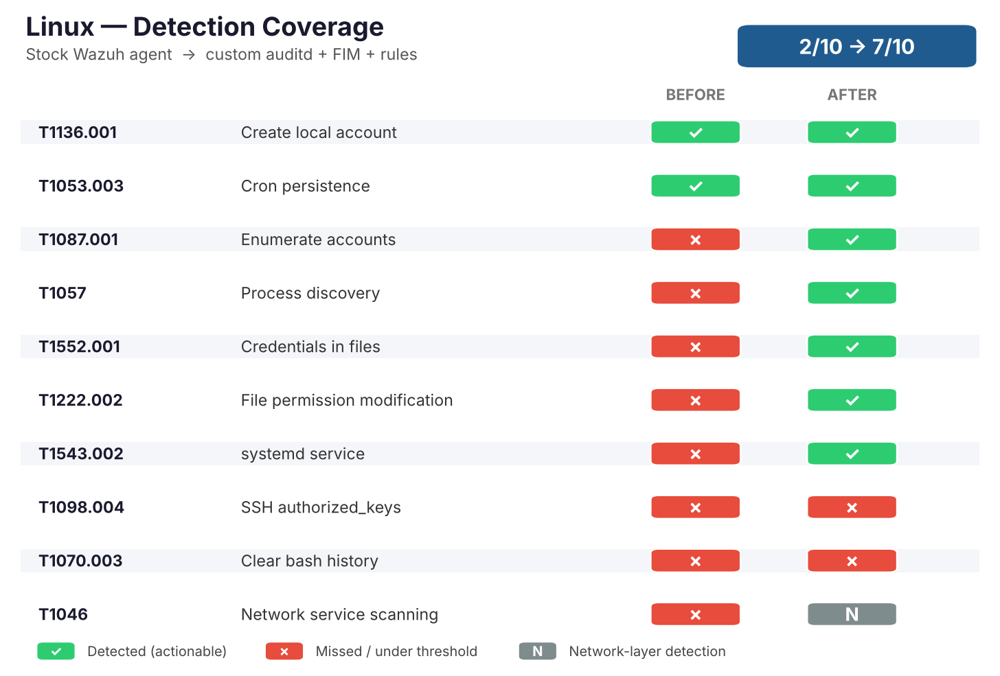
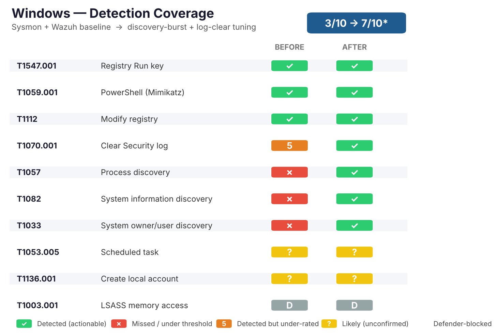
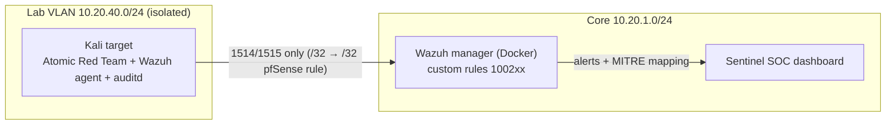

# 🟣 Purple-Team Detection Lab

Run real attacker techniques against my own isolated lab host, measure what my
**Wazuh SIEM** actually catches, write the rules to close the gaps, and prove the
before/after with evidence. Detection coverage went from **2/10 to 7/10** of the
tested MITRE ATT&CK techniques, with the three remaining gaps documented honestly
rather than papered over.

Every number here came from my own environment. The target is a Kali host pinned
to an isolated Lab VLAN; addresses are replaced with a `10.20.x.x` / `192.0.2.x`
plan and no credentials, keys or real IPs are published. Detections flow into my
SOC dashboard, **[Sentinel](https://github.com/KevinTechLabs/Homelab-Soc-Dashboard)**,
and extend the rule-tuning work in my
**[Homelab SIEM & Detection Lab](https://github.com/KevinTechLabs/Homelab-SIEM-Detection-Lab)**.

---

## Headline result

| | Techniques detected | Coverage |
|---|---|---|
| **Baseline** (stock Wazuh agent) | 2 of 10 | 20% |
| **After custom detections** | 7 of 10 | 70% |

A stock Linux agent reliably catches account and cron changes and little else.
Adding **auditd** command logging + **FIM** on sensitive paths, plus 9 custom
rules, closed five of the eight gaps. The remaining three are explained below —
one of them (port scanning) is deliberately left to the network layer, where it
belongs.

### Coverage at a glance







---

## How it was tested

1. **Execute** each technique with [Atomic Red Team](https://github.com/redcanaryco/atomic-red-team)
   via a runner that logs the exact UTC start/end of every test and cleans up after itself
   (`scripts/run_tests.sh`).
2. **Correlate** each test's time window against Wazuh alerts for the Kali agent,
   stripping runner noise (sudo/PAM/USB) so only real detections remain.
3. **Score** each technique detected / missed and record the matching rule ID
   (`techniques.csv`).
4. **Close the gaps** — write auditd rules + FIM config + Wazuh detection rules
   for the misses (`auditd/`, `rules/`).
5. **Re-run** the identical set and measure the jump.

---

## Techniques tested

| ATT&CK | Technique | Tactic | Baseline | After | Rule |
|---|---|---|:---:|:---:|---|
| T1136.001 | Create local account | Persistence | ✅ | ✅ | 5902 (built-in) |
| T1053.003 | Cron persistence | Persistence | ✅ | ✅ | 2833 (built-in) |
| T1087.001 | Enumerate local accounts | Discovery | ❌ | ✅ | 100202 |
| T1057 | Process discovery | Discovery | ❌ | ✅ | 100205 |
| T1552.001 | Credentials in files | Credential Access | ❌ | ✅ | 100203 / 100204 |
| T1222.002 | File permission modification | Defense Evasion | ❌ | ✅ | 100207 |
| T1543.002 | systemd service | Persistence | ❌ | ✅ | 100211 |
| T1098.004 | SSH authorized_keys | Persistence | ❌ | ❌ | *gap — see docs* |
| T1070.003 | Clear bash history | Defense Evasion | ❌ | ❌ | *gap — see docs* |
| T1046 | Network service scanning | Discovery | ❌ | ❌ | *network layer by design* |

---

## v2: Windows, and the cross-platform insight

v2 adds a **Windows 11** target with **Sysmon** feeding the same Wazuh manager.
The result is the mirror image of Linux and the most interesting finding in the
whole project:

| Platform | Telemetry | Baseline coverage |
|---|---|---|
| Linux (stock agent) | journald / default rules | **2/10** → 7/10 after custom rules |
| Windows (Sysmon) | Sysmon + Wazuh built-in rules | **strong out of the box** |

Windows caught registry Run-key persistence (92302, 92041), PowerShell dropping
executables (92203, 92205), registry modification (92041) and suspicious processes
(61638/61634) at actionable severity **with no custom rules at all**. The baseline
surfaced two weaknesses, both since closed with custom rules (verified by re-run):

| Gap | Before | After | Rule |
|---|---|---|---|
| Discovery (T1082/T1033/T1057) | under threshold | detected, level 10 | 100222 |
| Clear Security log (T1070.001) | detected but level 5 | elevated to level 12 | 100220 |


*The custom rules firing: discovery burst (100222, level 10) and the elevated
Security-log clear (100220, level 12).*

**The lesson isn't "Windows is safer." It's that detection coverage is a function
of telemetry and tuning.** The identical SIEM saw almost nothing on a bare Linux
host and a great deal on a Sysmon-instrumented Windows host — and even then, two
real gaps (a *visibility* gap and a *rating* gap) needed closing. Full write-up and
evidence: [`docs/windows-baseline.md`](docs/windows-baseline.md); more screenshots
in [`docs/screenshots/`](docs/screenshots/). Windows runner,
rules and matrix live in [`windows/`](windows/); Navigator layers are
[`navigator/windows-baseline.json`](navigator/windows-baseline.json) and
[`navigator/windows-after.json`](navigator/windows-after.json).

---

## The gaps, explained

Honest coverage beats a suspicious 10/10. Each miss has a write-up in
[`docs/gaps/`](docs/gaps/):

- **T1098.004 (SSH key)** — FIM watches `/root/.ssh` and `/home/*/.ssh` in real
  time, but the atomic added and then removed the key inside one scan interval.
  Fix tracked in the gap note (catch the `execve` of the key-adding command, not
  just the file state).
- **T1070.003 (clear history)** — the atomic cleared history with a shell builtin
  (`history -c`), which never writes the `.bash_history` file auditd is watching.
  Needs a `prompt_command`/shell-audit approach instead of a file watch.
- **T1046 (port scan)** — the atomic uses bash `/dev/tcp`, which spawns no process,
  so host tooling can't see it. Port scans are a **network** detection and are
  already covered by Suricata/pfBlockerNG on pfSense. Documented as a layering
  decision, not a failure.

---

## Detection ≠ tuning (a deliberate second lesson)

The first pass of the new rules generated **~1,240 alerts in an hour** — watching
every `/etc/passwd` read and every `chmod` on the box is loud. That is the normal
state right after writing a detection, not the finish line. The follow-up work
(scoping each rule to the malicious case, frequency thresholds, allow-listing the
benign binaries) mirrors the evidence-based tuning in my
[SIEM repo](https://github.com/KevinTechLabs/Homelab-SIEM-Detection-Lab) and is
tracked in [`docs/tuning.md`](docs/tuning.md).

---

## Repo layout

| Path | What it is |
|---|---|
| [`scripts/run_tests.sh`](scripts/run_tests.sh) | Runs each atomic, logs its UTC window, cleans up |
| [`scripts/check_detections.py`](scripts/check_detections.py) | Queries the Wazuh indexer per window → detected/missed table |
| [`rules/local_rules.xml`](rules/local_rules.xml) | The 9 custom Wazuh detection rules |
| [`auditd/purpleteam.rules`](auditd/purpleteam.rules) | auditd rules that tag each behavior with a technique key |
| [`auditd/ossec-agent-additions.xml`](auditd/ossec-agent-additions.xml) | FIM + audit log config added to the Kali agent |
| [`techniques.csv`](techniques.csv) | The full test matrix with both runs' results |
| [`navigator/`](navigator/) | ATT&CK Navigator layers (baseline + after) |
| [`docs/gaps/`](docs/gaps/) | One write-up per missed technique |
| [`docs/tuning.md`](docs/tuning.md) | Turning loud detections into usable ones |
| [`docs/screenshots/`](docs/screenshots/) | Dashboard evidence |

---

## Reproduce it

> ⚠️ Atomic Red Team really performs the actions it simulates. Run it only on a
> disposable host on an **isolated** network segment — never a daily driver.

```bash
# On the isolated target
sudo apt install -y auditd
sudo cp auditd/purpleteam.rules /etc/audit/rules.d/
sudo augenrules --load
# merge auditd/ossec-agent-additions.xml into /var/ossec/etc/ossec.conf, then:
sudo systemctl restart wazuh-agent

# On the Wazuh manager (append to local_rules.xml, then restart)
# run the tests
bash scripts/run_tests.sh
# score them
python3 scripts/check_detections.py results_*.csv
```

---

## Safety & scope

- Target is isolated on the Lab VLAN; its only path out is a single pfSense
  `/32 → /32` rule to the Wazuh manager on 1514/1515.
- No real IPs, hostnames, keys or credentials are published.
- This is a defensive detection-engineering project: the goal throughout is
  measuring and improving blue-team coverage.
