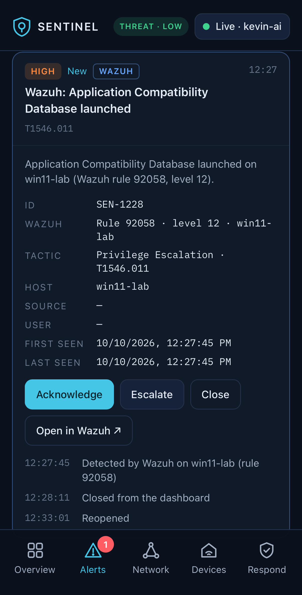

# Screenshots

## Windows — custom rules firing (the "after")

*Filtered to the custom rules: each discovery command tagged (100221), the
**Discovery burst** firing at level 10 (100222), and the **Security log clear**
elevated to level 12 (100220) — the two gaps closed.*

## Windows — the log-clear rating gap, before and after

*Same action, two ratings: stock Wazuh scores a cleared Security log at level 5
(rule 63103); the custom override (100220) raises it to level 12.*

## Windows — baseline detections (out of the box)

*Before any custom rules: Wazuh + Sysmon already catch PowerShell dropping
executables, registry Run-key / Base64 writes, and suspicious processes.*

---

## Sentinel integration — alerts flow to the SOC dashboard

*A Wazuh detection (T1546.011, rule 92058, level 12 on win11-lab) surfaced in
[Sentinel](https://github.com/KevinTechLabs/Homelab-Soc-Dashboard) with MITRE
tactic mapping, triage actions, and an activity timeline — installable on a phone.*

## ATT&CK coverage — before vs after

*Generated from the Navigator layers in [`../../navigator/`](../../navigator/).*

---

### Still worth adding (optional)

- **Linux credential-access alert** — the Sentinel / Wazuh **T1552.001
  "/etc/shadow"** alert at level 12, for the Linux side.

Capture more with a region screenshot (`grim -g "$(slurp)" ~/Pictures/shot.png`),
dragging the box **below the address bar** so no real IP is included.
