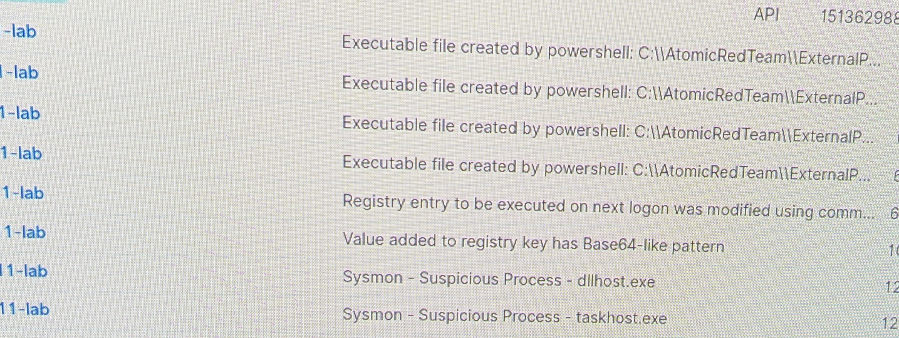

# Screenshots

*Wazuh catching Windows techniques out of the box (rule.level ≥ 6): PowerShell
dropping executables, registry Run-key / Base64 value writes, and Sysmon
suspicious-process alerts — no custom rules.*

---

Drop more dashboard evidence here and reference it from the main README. Grab
these as **native screenshots** (Windows `Win+Shift+S`, Linux screenshot tool) for
a clean look, and crop/blur any URL bar showing the real manager IP:

| File | What it shows |
|---|---|
| `baseline-events.png` | Filtered Wazuh events during the baseline run — only 5902/2833 fire |
| `after-custom-rules.png` | Wazuh events filtered to `rule.id:(100201..100211)` — the new detections |
| `sentinel-t1552.png` | The level-12 T1552.001 alert in Sentinel with MITRE tactic mapping |
| `navigator-before-after.png` | ATT&CK Navigator baseline vs after layers side by side |

Scrub any real IPs/hostnames before committing. The Navigator images can be
exported from [mitre-attack.github.io/attack-navigator](https://mitre-attack.github.io/attack-navigator/)
after loading `navigator/baseline.json` and `navigator/after.json`.
